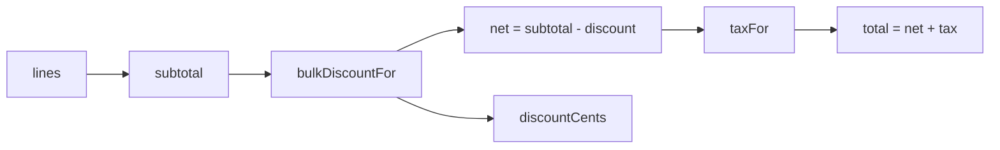

# Bulk discount — Design

Status: Designed — ready for /build
Ticket: 1
Requirements: `requirements.md` (no open questions; `decisions-log.md` absent, nothing to add)

## Impact analysis
No `docs/wip/analysis-*.md` report exists. The change adds one result field (`discountCents`) and
changes the values of `taxCents`/`totalCents` for subtotals >= 100000 — an intended effect per
requirements. No field is renamed or removed, so the public contract is not broken. External
importers could not be searched (other repos). No `docs/architecture/` exists; single library, so
no service boundaries are affected. No ADR: every decision below is cheap to reverse.

## Design decisions
1. **Where the rule lives — new `src/discount.js`** exporting `bulkDiscountFor(subtotalCents)` and the
   constants `BULK_THRESHOLD_CENTS = 100000` and `BULK_RATE_PERCENT = 10`. Mirrors `tax.js`
   (rule + constants in its own module, referenced to the pricing-rules doc).
   Alternative: inline in `index.js` — rejected, hides the rule and makes it harder to unit test.
2. **Rounding** — `roundCents((subtotalCents * 10) / 100)`, same pattern as `taxFor`; the only
   rounding path. Integer-valued inputs make 100005 -> 10000.5 exact, giving 10001 (AC-3).
3. **Flow in `calculateInvoice`**:
   `subtotal = sum(lines)` -> `discount = bulkDiscountFor(subtotal)` -> `net = subtotal - discount`
   -> `tax = taxFor(net, region)` -> `total = net + tax`.
   Return `{ subtotalCents, discountCents, taxCents, totalCents, lines }`.
   `subtotalCents` stays pre-discount (REQ-6). Discount is 0 below threshold, so tax/total are
   unchanged (REQ-4).
4. **Invalid input** — validation order is unchanged; an unknown region still throws from `taxFor`
   even when a discount applies (never a partial result).
5. **Not configurable** — threshold/rate are module constants, not options (out of scope).
6. **Non-negativity** — discount is 10% of a non-negative subtotal, so it is never negative and
   never exceeds the subtotal; no extra guard needed.

## Test plan (node:test, `npm test`)
- `test/discount.test.js`: 0 below threshold (99999), 10000 at exactly 100000, half-up case 100005 -> 10001.
- `test/invoice.test.js` (add cases): AC-1 (100000, US -> 10000 / 0 / 90000), AC-2 (150000, UK ->
  15000 / 27000 / 162000), AC-4 (99999, IN -> 0 / 18000 / 117999), AC-5 (`discountCents` present and 0),
  unknown region with qualifying subtotal still throws.
- AC-6: existing tests are not modified.

## Docs
- JSDoc return type of `calculateInvoice` gains `discountCents`.
- `docs/domain/pricing-rules.md` is not edited here (domain owner's file); its "No discount exists
  today" sentence becomes stale after release — flagged as a follow-up for the billing team.

## Open questions
None blocking. Follow-up (owner: billing team): update the Discounts section of pricing-rules.md.
Release note for tool developers: `taxCents`/`totalCents` change for subtotals >= 1000.00.
