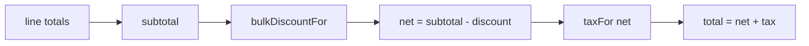

# Bulk discount — Design

Ticket: 1 · Requirements: `requirements.md` (REQ-1..6, AC-1..6)

## Impact analysis
No `docs/wip/analysis-*.md` report exists. The public result of `calculateInvoice` gains one field
(`discountCents`, additive). `taxCents` and `totalCents` change in value for subtotals >= 100000;
this is the intended effect stated in the requirements. No fields are renamed or removed, so this is
not a breaking change to the contract. Consumers in other repos were not searched (per requirements).
No `docs/architecture/` documents exist. No ADR needed: the choices below are reversible and local.

## Decisions
1. **Where the rule lives:** new `src/discount.js` exporting `bulkDiscountFor(subtotalCents)` and
   the constants `BULK_THRESHOLD_CENTS = 100000`, `BULK_RATE_PERCENT = 10`. This mirrors
   `tax.js` (constants plus one pure function), keeps `index.js` thin and the rule easy to find.
   Alternative (inline in `index.js`) rejected: the rule would be hidden among orchestration.
2. **Rounding:** `roundCents((subtotalCents * 10) / 100)`, the same form `taxFor` uses; only
   `roundCents` rounds (convention). 100005 -> 10000.5 -> 10001 (AC-3). Operands are integers
   and `k + 0.5` is exact in floating point, so half cases are safe.
3. **Calculation order in `calculateInvoice`** (matches pricing-rules.md):
   subtotal -> `discountCents = bulkDiscountFor(subtotal)` -> `netCents = subtotal - discountCents`
   -> `taxCents = taxFor(netCents, region)` -> `totalCents = netCents + taxCents`.
4. **Result shape:** `{ subtotalCents, discountCents, taxCents, totalCents, lines }`.
   `subtotalCents` stays pre-discount (REQ-6). `discountCents` is always present, 0 when none (AC-5).
5. **Not configurable:** threshold and rate are module constants, not parameters (requirements).
6. **Errors/edge cases:** validation is unchanged. Unknown region still throws, including for
   discounted invoices, because `taxFor` is still called on every invoice. Discount is at most 10% of
   the subtotal, so no amount can go negative (pricing-rules). Threshold is inclusive (`>=`).

## Build tasks
- Add `src/discount.js`.
- Edit `src/index.js`: compute discount and net, add `discountCents`, update JSDoc return type.
- Tests (`node:test`): `test/discount.test.js` for `bulkDiscountFor` (below, at, above threshold,
  half-cent rounding); extend invoice tests for AC-1..AC-5, including 99999 and 100000 boundaries.
  Existing tests must pass unchanged (AC-6).
- Update the "Discounts" section of `docs/domain/pricing-rules.md` is owned by the billing team and
  is not changed by this build.

## Open questions
None.
